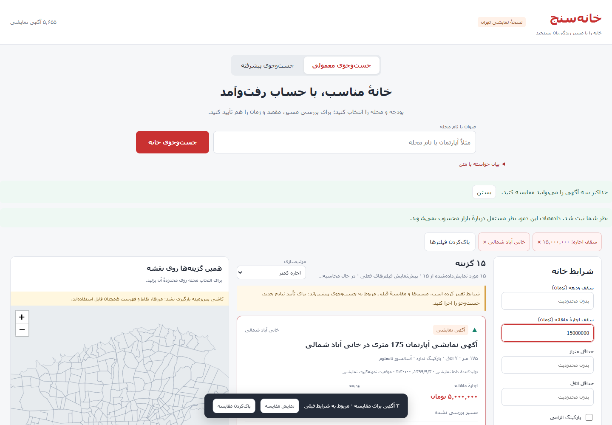
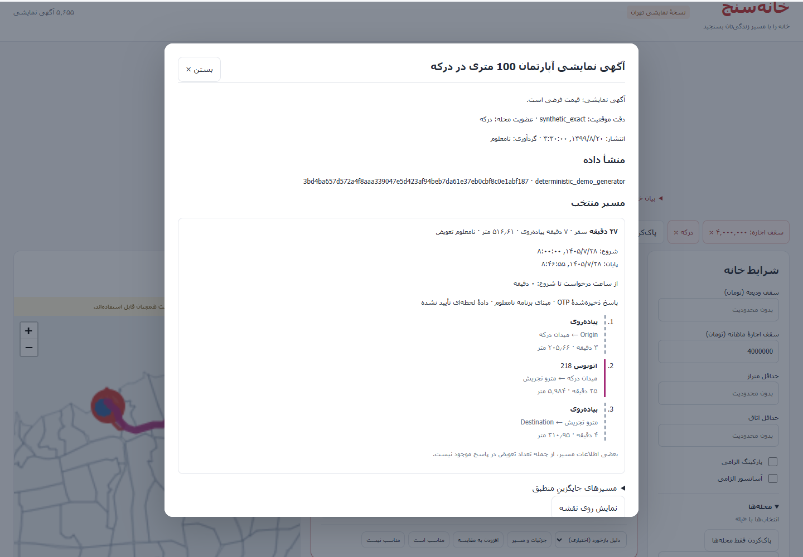

# Phase 2 handoff — خانه‌سنج

This phase extends the existing local application. Read `handoff-phase-1.md` for the
original data provenance, seed, contracts and verified OTP evidence. Code comments and
docstrings are English; the product interface is Persian RTL. Verification is recorded
in `phase-2-verification-report.json`; final browser and regression checks passed on 2026-10-21.

## Architecture and dependency boundaries

```mermaid
flowchart LR
  Form[Normal form / confirmed intent] --> State[Shared versioned state]
  State --> Worker[Browser filtering worker]
  Inventory[Versioned public demo inventory] --> Worker
  Worker --> View[Same list and map results]
  State --> API[FastAPI / server validation]
  API --> SQL[(SQLite canonical facts and snapshots)]
  Advanced[Advanced explicit submission] --> API
  SQL --> Encoder[Pinned local multilingual E5 encoder]
  Encoder --> Qdrant[(Local persistent Qdrant)]
  Qdrant --> Recheck[Canonical SQLite hard-filter recheck]
  Recheck --> Snapshot[All structured eligible candidates]
  Snapshot --> OTP[Bounded OTP worker and cache]
  OTP --> Rank[Versioned deterministic utility]
  Rank --> View
  Rank --> Explain[Evidence-derived templates]
  Explain --> AI[Optional AvalAI verified claim selection]
  View --> Feedback[Explicit feedback / frozen Top-5]
  Feedback --> SQL
  SQL --> Review[Bounded review queue / offline learning gate]
```



Normal Search performs no embedding, Qdrant or LLM request. Form changes use a browser
worker against the public inventory; a confirmed server search creates an immutable
candidate snapshot. No destination means no OTP request. The existing Leaflet mapping
stack remains. No PostgreSQL/PostGIS, Redis, Kafka or alternative routing engine was added.

Advanced Search returns structured results while semantic retrieval runs asynchronously.
The query encoder and the indexed properties use the same model revision. Qdrant/FTS5
rank fusion prioritizes candidates for bounded routing and breaks exact utility ties.
**Every structured-eligible candidate is retained.** A vector top-K is never a proof of
global completeness, and no semantic score bypasses hard constraints. Unknown/failed
travel evidence is exposed separately in `unverified_results`, never as verified matches.

## Run and maintain

From the repository root in PowerShell:

```powershell
.\.venv\Scripts\python.exe -m pip install -r requirements-lock.txt
.\.venv\Scripts\python.exe -m backend.app.cli migrate
docker compose -f compose.qdrant.yml up -d
.\.venv\Scripts\python.exe -m backend.app.semantic download-model --report docs/embedding-verification.json
.\.venv\Scripts\python.exe -m backend.app.semantic index --report docs/qdrant-index-report.json
.\.venv\Scripts\python.exe -m backend.app.semantic reconcile --report docs/qdrant-reconcile-report.json
cd frontend
npm ci
npm run build
cd ..
.\.venv\Scripts\python.exe -m uvicorn backend.app.main:create_app --factory --host 127.0.0.1 --port 8000
```

Open `http://127.0.0.1:8000`; API reference is `/docs`. Use the existing `.env`, or copy
`.env.example` only when it does not already exist. The database remains
`runtime/khanehsanj.sqlite3`; `DATABASE_URL` takes precedence over optional
`SQLITE_DB_PATH`. Do not seed on startup. The persisted inventory still contains 5655
demo listings from seed 2026, with 1885 in each series and no shortage. Existing seed
identity and provenance are unchanged.

Qdrant uses `qdrant/qdrant:v1.15.4`, loopback port 6333 and the named Docker volume
`homesanj_qdrant_storage`. Only the backend accesses it. The local default has no API
key; configure server and backend keys together if adding authentication. OTP continues
on port **8821** and was neither reinstalled nor exposed. Docker backend networking was
not retested; the application here runs on the Windows host directly.

## Canonical contracts, state and sessions

`backend/app/contracts.py` remains canonical; regenerate JSON Schema/TypeScript with
`python -m backend.app.export_schema`. Existing `schema_version=1.0.0` remains accepted;
the optional additive `soft_preferences` field is a list of parking/elevator/finance/
travel preferences. Parser and ranking implementations carry independent version 2 IDs.
Unknown values stay null. A false requirement means no requirement. Internal patches
are allowlisted and atomic, not RFC 6902. `remove` restores the documented default.

Neighborhood selections are OR, district selections are OR, and those groups combine
with other conditions by AND. District membership comes from point-in-district geometry.
The browser has the same IDs and membership lists as the server. Boundary points use
`covers`; overlaps retain all memberships and are labeled ambiguous. Contradictions
remain visible and do not silently clear selections.

The local browser receives an opaque HttpOnly SameSite=Strict session cookie. Search,
snapshot, replay, parent/task lineage, feedback and explanation access is checked against
server-owned session attribution. Cross-origin unsafe browser requests are rejected.
Old phase-one snapshots remain in SQLite but are not automatically assigned to a new
browser session. This is a local session boundary, not a general public authentication
system. The internal review API additionally requires `REVIEW_API_TOKEN`.

The public inventory endpoint sends only demo listing display facts, actual computed
membership IDs and normalized keyword text. It omits raw source records and destinations.
ETag, gzip and a persisted SQLite inventory revision invalidate the cached snapshot when
listings change. Real imported listings are not automatically published to browser inventory.

## APIs

Existing phase-one APIs remain, including state/default/schema/patch, geographic layers,
search create/read/cancel/continue/snapshot/replay and provider health.

| Endpoint | Purpose |
| --- | --- |
| `GET /api/inventory` | Versioned safe demo inventory, ETag/304 |
| `POST /api/intent` | Contextual proposal, hard patches, soft preferences and clarifications |
| `POST /api/searches` | Exact structured search; no semantic/LLM dependency |
| `POST /api/advanced/searches` | Confirmed state plus semantic text; progressive retrieval |
| `POST /api/searches/{id}/explanation` | Deterministic comparison; optional enabled AI claim selection |
| `POST /api/events` | Allowlisted, deduplicated session-scoped events |
| `POST /api/feedback` | Explicit property or frozen Top-5 relevance |
| `GET /api/measurements/{request_id}` | Immutable first-final/deadline measurement |
| `GET /api/metrics` | Current-session metrics with unresolved denominators |
| `POST /api/review/sample` | Bounded auditable sample selection |
| `GET /api/review/queue` | Restricted reviewer queue |
| `POST /api/review/{id}/suggest` | Optional unconfirmed AI annotation suggestion |
| `POST /api/review/{id}/annotation` | Restricted human confirmation |

Search results include task/request/parent/snapshot/state revision, candidate and eligible
counts, evaluated count, completion status, ranking scope, cache hit/miss counts, ranking
policy and independent semantic status. Semantic pending does not make a provisional
ranking final. A confirmed new destination creates a new independent task; changes under
the same need retain lineage. Replay never invokes an external service.

## SQLite, ingestion and spatial assignments

Migration 1 is the original foundation. Migration 2 adds composite price/attribute indexes,
persisted actual geometry assignments, indexed membership rows, FTS5, semantic request
metadata and inventory revision triggers. Migration 3 adds events, frozen measurements,
explicit feedback, review samples/annotations and explanation cache. Session and private
state audit tables are additive. Migrations are idempotent and do not overwrite listings.

SQLite uses WAL, foreign keys and a bounded busy timeout; write transactions are short.
Concurrent search tests exercise three workers, not arbitrary writer scalability. FTS5
uses normalized Persian/Arabic digits and ی/ک, NFKC and ZWNJ spacing, Unicode61 tokens,
AND prefix matching for normal keyword search; advanced lexical union uses OR terms.
Values are bound. If FTS5 is unavailable, the bounded normalized-token scan is disclosed.
R*Tree is unnecessary for the current point inventory because exact polygon assignments
are persisted and queried through indexed membership rows.

The 377 neighborhoods/22 districts remain the pinned November 2020 source, with two
recorded geometry repairs, 120 overlap pairs, 108 source district deviations above 1%
and 11 above 50%. Neither current official coverage nor a newly verified data licence is
claimed. See the unchanged source manifest and validation report.

## Qdrant and embeddings

Collection: `homesanj_properties_v1`, 384-dimensional cosine dense vectors. Encoder:
`Xenova/multilingual-e5-small`, exact revision
`761b726dd34fb83930e26aab4e9ac3899aa1fa78`, quantized ONNX CPU, masked mean pooling,
L2 normalization and E5 query/passage prefixes. This is separate from Gemini reasoning.
Dependencies and download file checksums are pinned; no fabricated/hash embeddings exist.
Property IDs map deterministically to UUIDv5 Qdrant point IDs.

Payload contains factual descriptions from known canonical fields, source/dataset versions,
actual district membership, amenity present/absent/unknown states and content fingerprints.
Shared indexing accepts synthetic listings or real records explicitly marked public.
Index/reconcile compares fingerprints, model/collection versions, missing/stale/orphan
points and payload indexes. Batch upserts and orphan deletion are idempotent and resumable.
Model/dimension mismatch requires an explicit compatible rebuild; no silent replacement.

Real execution evidence: `embedding-verification.json`, `qdrant-index-report.json`,
`qdrant-reconcile-report.json`, `advanced-semantic-live-report.json` and
`semantic-benchmark.json`. All 5655 points were indexed; reconciliation found zero drift.
The real advanced API test retained 707 eligible listings, retrieved 100 semantic candidates
with over-retrieval and recorded zero invalid hard matches. Small authored Persian fixture
relevance is not independent user satisfaction evidence; no Hit Rate improvement is claimed.

## Intent, explanations and AvalAI

The contextual parser preserves confirmed fields, resolves names against real IDs, separates
hard requirements from soft preferences and resolves tomorrow in Asia/Tehran. Ambiguous
money units, duplicate names, dates and missing destinations hold search pending. Effective
constraints require confirmation. Unknown quiet/safe/metro claims are never made into facts.

Normal parser default is deterministic; `INTENT_LLM_ENABLED=false`. Advanced reasoning uses
its independent `ADVANCED_AI_ENABLED` and `ADVANCED_REASONING_MODEL` settings. All paid
calls remain backend-only, account-discovered, smoke-gated, bounded and budgeted. Preferred
`gemini-3.6-flash` is configured but **not verified against a real account in this environment**.
No key is configured and no paid call was made. Real AvalAI smoke is **NOT RUN**.

After adding a backend key and explicitly enabling the intended role, run:

```powershell
.\.venv\Scripts\python.exe -m backend.app.cli avalai-smoke --allow-paid --max-requests 1
```

Model identity is never silently substituted. JSON-schema capability is not assumed;
bounded JSON is Pydantic-validated with at most one parser repair. Recommendations use a
bounded same-snapshot evidence pack and typed comparisons whose truth is checked, not
merely references to existing facts. Provider prose cannot change eligibility or numeric
rank. Missing providers return evidence-derived templates. Private destinations, full raw
queries, database dumps and complete geometry are not sent for explanation.

## Ranking, routes and candidate scope

`fixed-reference-utility-2` is a cost (lower is better), not satisfaction probability.
Balanced weights are rent/deposit/duration/walk/transfers = .30/.20/.25/.15/.10. Normalization
uses confirmed positive caps or fixed reference scales 30m toman/1bn toman/3600s/900s/3;
values are capped at 1 and unknown receives cost 1. Explicit preferences change weights;
soft known parking/elevator each contribute a disclosed .025 bonus. Without destination,
only finance weights are active and renormalized. Scales never depend on a result page.

Exact price and travel sorts implement every documented tie-break. Walk/fast/transfer sort
chooses the corresponding qualifying itinerary first; all displayed metrics come from that
same itinerary. A travel sort without destination/date/time is rejected with clarification.
Hard constraints are evaluated jointly on each returned itinerary, including all walking
legs. Unknown active evidence cannot pass. No-route, timeout/API error and infeasible
returned alternatives remain distinct. No claim about every possible OTP route is made.

Existing OTP 2.10.0 uses the verified `/otp/transmodel/v3` path and BUS mode. Root reachability
and routing verification remain distinct. Schedule provenance and graph version are unknown;
realtime is unavailable in observed responses. Aggregate transfer counts are unavailable,
so a hard transfer cap cannot be verified; null is retained. This limitation is visible.

Routing remains bounded to concurrency 3 and configurable batch 30 by default, with global
database lease, cancellation and restart recovery. Cache keys include exact locations,
effective dates/times/modes/options/API/adapter/graph identity and fixture state, TTL one hour.
Sort-only changes reuse route alternatives. A three-property live acceptance test obtained
three eligible routes and then three cache hits with zero new OTP calls after walking sort.
Partial results describe only the evaluated subset, never the best across Tehran.

## Feedback, events and learning

Backend owns event identity, lineage, actor kind and trusted verdicts. Explicit suitable/
unsuitable feedback is separate from clicks/saves/impressions and AI suggestions. Top-5
positive feedback must name at least one property in the frozen set. Negative single-item
feedback does not label other candidates. Idempotency keys prevent duplicates.

The first final result after confirmed intent freezes a task's Top-5 once. Semantic pending
and provisional routing do not freeze final rankings. Deadline measurements retain failures
and actually exposed partial candidates; later edits do not rewrite old measurements.
Display and impression differ: the default impression policy is 50% visibility for one
second. Events store allowlisted metadata, not private free text or exact destinations.

Review sampling records disagreement, diversity, near-boundary and missing-evidence reasons;
it does not pretend to have calibrated model uncertainty. AI suggestions remain unconfirmed,
with evidence refs and mandatory human review. Offline learning excludes synthetic/demo/test,
implicit and AI labels and splits connected task/session/property groups to reduce leakage.
Current independent labels: zero. `phase-2-learning-report.json` reports insufficient data;
the deterministic baseline remains active. No relevance lift is claimed.

```powershell
.\.venv\Scripts\python.exe -m backend.app.feedback train --output docs/phase-2-learning-report.json
```

Hit Rate@5/Success@5 use explicit labels, with positive/negative/unresolved denominators
separate. Precision/NDCG require sufficient judged candidates, never treating unjudged as
negative. Metrics are split by search mode, actor and frozen scope. Routing coverage, cache
ratio and separate latency components are reported; model lift/annotation agreement remain
unmeasured without suitable independent labels.

## Verification and known limits

Measured local reports:

- `sqlite-phase-2-benchmark.json`: indexed SQL/FTS5/API timing and covering-index query plan.
- `semantic-benchmark.json`: vector/lexical/hybrid relevance fixture and retrieval latency.
- `phase-2-live-acceptance.json`: three live OTP routes, sort cache reuse and template explanation.
- `phase-2-learning-report.json`: zero eligible independent human labels; no trained rollout.

Commands for final regression and browser verification:

```powershell
.\.venv\Scripts\python.exe -m pytest -q
.\.venv\Scripts\python.exe -m backend.app.benchmark
.\.venv\Scripts\python.exe -m backend.app.acceptance_phase2
cd frontend
npm test
npm run build
npx playwright test
```

Final results: **97 backend tests, 8 frontend tests, 6 browser scenarios and production build PASS**.
See `phase-2-verification-report.json` and `phase-2-browser-report.json`. Real AvalAI, an authenticated external geocoder, cloud deployment and Docker
backend-to-OTP networking are not verified. The app does not pretend those connections work.
Phase 3 should add independent human evaluation, documented schedule/feed provenance,
production authentication if leaving localhost, retention policy and reviewed model rollout.


## Final browser walkthrough and operational notes

The single application entry `/` provides independently selectable Normal and Advanced modes.
The deterministic contextual text parser is also available from the expandable normal-search
panel. Three examples use loaded neighborhood names. Clearing only neighborhoods is separate
from clearing hard filters; confirmed destination/time and unrelated preferences persist.
The browser worker filters and sorts the persisted inventory and displays the same page on the
map. Pending routing does not turn those property previews into verified travel results.

Executed browser coverage includes local filtering without search submission, two-way map/list
selection, explicit destination/time, real OTP routes and readable route legs, three-home comparison,
stale comparisons, explicit feedback, contextual parking/less-walking edits, neighborhood-only
clearing, real Qdrant search with confirmed hard constraints, deterministic explanations, mobile
layout, deliberately unavailable tiles and ignored stale search responses. The map uses Canvas;
walking geometries use dashed styling, transit geometries solid styling. No geocoder is implied.





The final bounded API acceptance is `phase-2-live-acceptance-final.json`: three eligible real OTP
routes, then three cache hits and zero misses on walking sort. Its OTP P50/P95 were approximately
248/441 ms for three samples. `sqlite-phase-2-benchmark.json` and `semantic-benchmark.json` retain
separate local SQL/API and semantic measurements; these small samples are not a production SLA.

`frontend/.env.example` documents the public OSM-compatible tile URL; retain appropriate provider
attribution if changing providers. The current OSM attribution is always displayed. The UI loads no
API secrets or private user destinations from other sessions. Card provenance and observed
schedule limitations remain visible. Optional feedback reasons are allowlisted category codes.

Client events record actual rendered/impression/click/route/comparison/filter/mode actions.
Indexed event validation avoids reranking every candidate for each card event. Frozen measurements
return immediately after ownership checks; demo properties and fixture routes cannot become
real-user relevance evidence. Backend deadline sweeping continues after the browser closes.

The agent's restricted process environment returned HTTP 503 to local OTP during one check.
Running the backend directly on the host passed the same flow; no OTP service, graph or binding
was changed. Ordinary local startup commands above run in the host environment. Do not interpret
a successful root page as a routing contract test.

Remaining external limits are explicit: no AvalAI account key/model capability was verified; no
paid request was made; no independent human relevance dataset exists. Available deterministic
and offline failure tests cover those unavailable-provider paths. Production label agreement,
model lift and meaningful user-level Precision/NDCG remain unavailable without independent labels.
Phase 3 can start from the current schemas, frozen evidence, restricted review APIs and reports.
